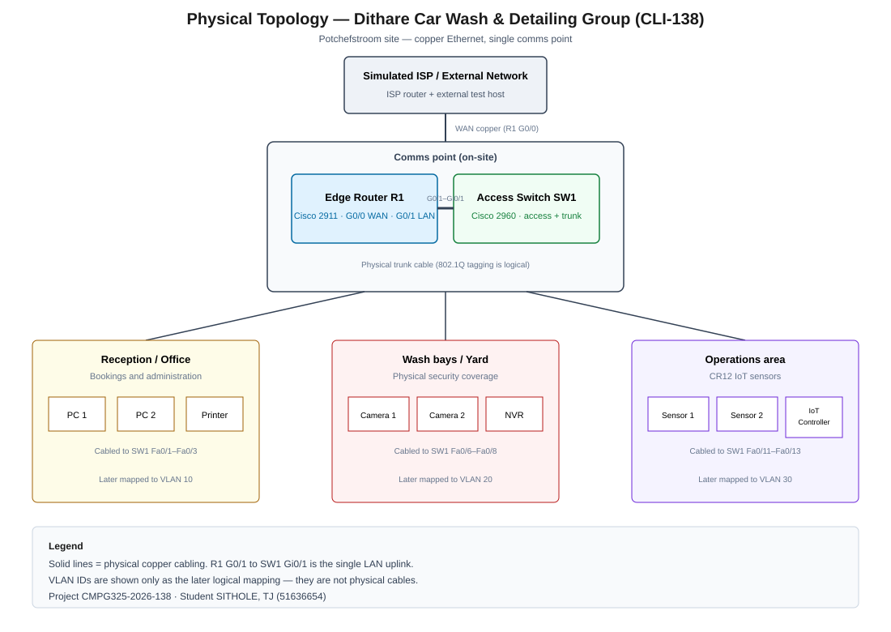

# Physical Topology

**Project ID:** CMPG325-2026-138  
**Client ID:** CLI-138  
**Student:** SITHOLE, TJ (51636654)  
**Organisation:** Dithare Car Wash & Detailing Group  
**Location:** Potchefstroom  
**Industry:** Automotive  

---

## 1. Purpose

This document describes the physical topology for the Dithare Car Wash & Detailing Group network.

It shows the physical devices and connections that form the foundation for the logical topology, IP addressing plan, and Cisco Packet Tracer implementation.

The design uses a single edge router and a single access switch to provide connectivity for three traffic segments:

- Office Data  
- CCTV  
- IoT / Operations  

---

## 2. Physical Network Structure

The physical network consists of:

1. A simulated external network (ISP / Internet)
2. An edge router (**R1**) as the boundary between the internal network and the external network
3. An access switch (**SW1**) providing connectivity to all end devices
4. Office devices
5. CCTV devices
6. IoT / Operations devices

This is a simple, centralised router-and-switch design appropriate for a single small site.

### 2.1 Physical Devices

| Device                  | Quantity | Purpose                                          |
|-------------------------|----------|--------------------------------------------------|
| Cisco 2911 Router       | 1        | Edge routing, inter-VLAN routing and NAT/PAT     |
| Cisco 2960 Switch       | 1        | VLAN connectivity and 802.1Q trunk to the router |
| Office PCs              | 2        | Represent office users                           |
| Printer                 | 1        | Represent office peripheral                      |
| CCTV Cameras            | 2        | Represent physical security devices              |
| NVR                     | 1        | Represent CCTV recording and storage             |
| IoT Sensors             | 2        | Represent operational IoT devices                |
| IoT Controller          | 1        | Represent IoT management / control device        |
| ISP / External Router   | 1        | Simulated external network for NAT testing       |
| External Server / PC    | 1        | Destination for external connectivity testing    |

**Total:** 13 devices

These are representative devices for the Packet Tracer implementation. The project brief does not specify exact quantities.

---

## 3. Physical Connections

| From                       | Interface / Port     | To                              | Connection Type | Purpose                     |
|----------------------------|----------------------|---------------------------------|-----------------|-----------------------------|
| Simulated External Network | WAN link             | R1 G0/0                         | Ethernet        | Outside / NAT boundary      |
| R1                         | G0/1                 | SW1 (trunk port)                | 802.1Q Trunk    | Carries VLANs 10, 20 and 30 |
| SW1                        | Access ports         | Office devices (PC 1, PC 2, Printer) | Access     | VLAN 10 connectivity        |
| SW1                        | Access ports         | CCTV devices (Cameras, NVR)     | Access          | VLAN 20 connectivity        |
| SW1                        | Access ports         | IoT devices (Sensors, Controller) | Access        | VLAN 30 connectivity        |

> **Note:** Exact switch port numbers will be confirmed during the Packet Tracer build and must match the final `.pkt` file.

---

## 4. Internal Device Groups

### 4.1 Office Data — VLAN 10

Representative devices used for administration and bookings:

- PC 1  
- PC 2  
- Printer  

This segment requires access to the simulated external network.

### 4.2 CCTV — VLAN 20

Representative security equipment:

- Camera 1  
- Camera 2  
- NVR  

CCTV traffic is separated from Office traffic using VLAN segmentation.

### 4.3 IoT / Operations — VLAN 30

Representative operational devices:

- Sensor 1  
- Sensor 2  
- IoT Controller  

IoT devices are placed in their own dedicated segment.

---

## 5. Router and Switch Relationship

**R1** is the edge router for the internal network.

The link between R1 and SW1 is an **IEEE 802.1Q trunk**. This single physical connection carries traffic for:

- VLAN 10 — Office Data  
- VLAN 20 — CCTV  
- VLAN 30 — IoT / Operations  

R1 will use a router-on-a-stick configuration for inter-VLAN routing where required. Traffic control between VLANs will be defined in the logical topology and configuration documents.

---

## 6. NAT Boundary

- **R1 G0/0** is the NAT outside interface (connected to the simulated external network).
- **R1 G0/1 subinterfaces** are the NAT inside interfaces for the internal VLANs.

Only Office devices are expected to require external access. Detailed NAT/PAT rules will be documented in the logical topology and configuration sections.

---

## 7. Physical Topology Diagram

**Legend**
- Solid lines = physical cabling  
- Trunk link carries VLANs 10, 20 and 30 (802.1Q tagged)  
- No dedicated Management VLAN is used. Management is performed via existing network interfaces (as per client requirements, Scope Note §6).

---

## 8. Design Rationale

The design uses **one edge router** and **one access switch** to keep the network appropriate for the project scope and business size.

A single 802.1Q trunk allows multiple VLANs to share one physical link while remaining logically separated.

Separate VLANs are used for Office, CCTV and IoT traffic to meet the client’s segmentation requirements.

A dedicated Management VLAN is not included because it falls outside the required project scope.

---

## 9. Packet Tracer Implementation

The physical topology will be built in Cisco Packet Tracer using:

- One Cisco 2911 (or equivalent) edge router  
- One Cisco 2960 (or equivalent) access switch  
- Representative Office, CCTV and IoT devices  
- A simulated external network  

Physical connections and interface assignments will be recorded so that the documentation matches the final `.pkt` file.

---

## 10. Document Control

| Version | Date       | Author      | Changes                                                                 |
|---------|------------|-------------|-------------------------------------------------------------------------|
| 1.0     | 2026-08-27 | SITHOLE, TJ | Initial physical topology documentation for Milestone 1                 |
| 1.1     | 2026-08-27 | SITHOLE, TJ | Added device table, refined connections, cleaned physical vs logical separation |
| 1.2     | 2026-08-27 | SITHOLE, TJ | Improved NAT Boundary wording                                           |
| 1.3     | 2026-08-27 | SITHOLE, TJ | Refined writing style for clarity and professionalism                   |

---

## 11. Related Project Documents

- `Client_Requirements.md` — Client requirements, constraints and design decisions  
- `physical_topology.svg` — Visual representation of the physical topology  
- `logical_topology.md` — Logical VLAN, routing and traffic-flow design  
- `IP_Addressing_Plan.md` — Complete IP addressing scheme  