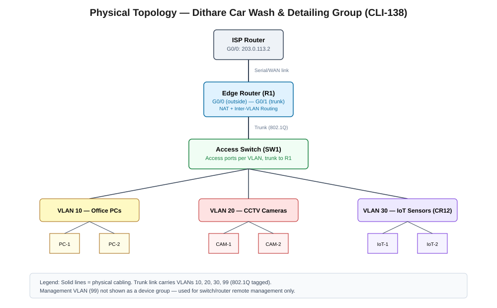
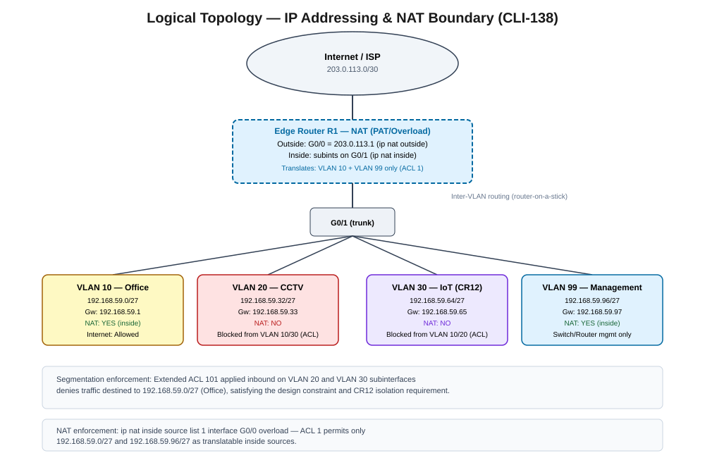

# Network Topology

## 1. Physical Topology

**Design summary:**

- One **ISP Router** simulates the internet/outside network, connected via a WAN link to the edge router.
- One **Edge Router (R1)** is the single point of routing, NAT, and inter-VLAN traffic control.
- One **Layer 2 Access Switch (SW1)** connects all end devices, trunked to R1 (router-on-a-stick).
- End devices are grouped by function: Office PCs, CCTV cameras, and IoT sensors, each on
  dedicated access ports assigned to their VLAN.

This is a router-on-a-stick design chosen because it keeps the physical build simple (single
router, single switch — appropriate for a single small site) while still allowing full logical
separation of the three traffic types required by the brief.

## 2. Logical Topology

**Design summary:**

- Four VLANs / subnets carved from `192.168.59.0/24`: Office (10), CCTV (20), IoT (30),
  Management (99) — see `03-ip-addressing-plan.md` for full addressing detail.
- **NAT boundary** sits at R1: G0/0 is `ip nat outside`, the Office and Management subinterfaces
  are `ip nat inside`. Only Office and Management traffic is translated to the outside address —
  CCTV and IoT are excluded, since they have no requirement to reach the internet.
- **Segmentation ACL (101)** applied on the CCTV and IoT subinterfaces denies traffic toward the
  Office subnet in both directions, directly satisfying the design constraint ("CCTV traffic must
  be segmented from office data traffic") and CR12 ("IoT sensors... need an isolated segment").

## 3. Mapping to Brief Requirements

| Brief item | How the topology addresses it |
|---|---|
| §8 Design Constraint (CCTV segmentation) | VLAN 20 isolated at L2 + ACL 101 blocks VLAN 20 ↔ VLAN 10 at L3 |
| §10 CR12 (IoT isolated segment) | VLAN 30 isolated at L2 + ACL 101 blocks VLAN 30 ↔ VLAN 10 at L3 |
| §9 Assigned Challenge (NAT) | PAT/overload on R1, inside sources restricted to VLAN 10 + VLAN 99 |
| §7 Use assigned addressing block | All VLANs subnetted from 192.168.59.0/24 |

## 4. Notes for Packet Tracer Build

- Router: any ISR model supporting subinterfaces and NAT (e.g. 4321 or 2911).
- Switch: any model supporting VLANs and trunking (e.g. 2960).
- Trunk port must allow VLANs 10, 20, 30, 99 and set a native VLAN (recommend native = 99,
  matching common practice of not using VLAN 1 as native).
- End devices: PCs for Office; PCs or the closest available Packet Tracer device (e.g. IP camera
  if available, else generic PC/end device) to represent CCTV; IoT devices via Packet Tracer's
  IoT/MCU-style end devices or generic PCs to represent sensors, depending on template version
  used.
